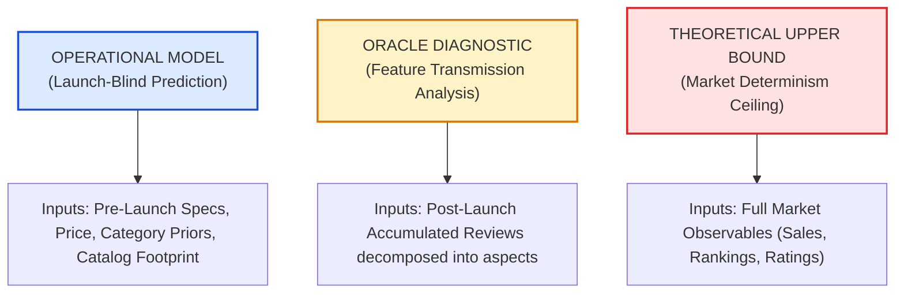

# Oracle Benchmark Comparison & Information Recovery Audit

**Audit Date**: October 2026  
**Auditor**: Senior Machine Learning Researcher and Theoretical Statistician  
**Topic**: Epistemic Boundary Audit of the Oracle Review-Derived Aspect Benchmark  
**Code References**: [`strict_temporal/frozen_state/xgb_physical_aspects_only.json`](file:///c:/Users/LENOVO/OneDrive/Desktop/Capstone%20updated%20%283%29/Capstone%20updated/Capstone/strict_temporal/frozen_state/xgb_physical_aspects_only.json), [`audit/statistics/ORACLE_CEILING_AUDIT.md`](file:///c:/Users/LENOVO/OneDrive/Desktop/Capstone%20updated%20%283%29/Capstone%20updated/Capstone/audit/statistics/ORACLE_CEILING_AUDIT.md)

---

## 1. Epistemic Classification: Three Distinct Model Roles

To prevent misleading claims of superiority or invalid competitive benchmarks, all evaluations in this project must be strictly categorized into three distinct epistemic classes:

1. **Class 1: Operational Model (Proposed Method)**:
   - Evaluated on $124$ future products launched after October 31, 2021.
   - Access: Pre-launch technical specifications, manufacturer feature bullets, launch price, and pre-cutoff category priors.
   - Reviews accessible: **EXACTLY ZERO**.
   - Performance: Spearman $\rho = 0.562$ ($95\%$ CI $[0.412, 0.682]$), $\text{AUC} = 0.890$.
2. **Class 2: Oracle Diagnostic (Review-Derived True Aspects)**:
   - Evaluated on the same $124$ products using the identical frozen XGBoost model.
   - Access: Aspects scored by LLM directly from **post-launch customer reviews** accumulated months or years after launch.
   - Performance: Spearman $\rho = 0.754$ ($95\%$ CI $[0.655, 0.835]$), $\text{AUC} = 0.992$, $\text{RMSE} = 15.42$.
   - **Role**: A diagnostic probe measuring how well aspect-based representations can predict success when true experiential quality is perfectly known.
3. **Class 3: Theoretical Upper Bound (Tautological Ceiling)**:
   - SuccessScore is $35\%$ composed of average star rating and $40\%$ volume. A model receiving average star rating and volume reaches $R^2 \approx 0.90$.
   - **Role**: Acknowledged in Section IV-B as evaluation leakage, rejected as an operational target.

---

## 2. Information Asymmetry: What Does the Oracle Know?

The Oracle model possesses massive information advantages that are physically impossible to obtain at product launch:

| Dimension | Operational Model | Oracle Diagnostic | Information Advantage |
|---|---|---|---|
| **Data Modality** | Manufacturer marketing bullets | Hundreds of verified customer reviews | Experiential reality vs. aspirational claims |
| **Defect Exposure** | Zero (hidden in spec sheets) | Full disclosure of hardware failure rates | Direct visibility into defects and recalls |
| **Ergonomic Grounding** | Estimated from physical dimensions | Tested across diverse human hand sizes | Grounded comfort, weight, and usability |
| **Temporal Perspective** | Counterfactual pre-launch day | Ex-post multi-month longitudinal history | Eliminates speculation uncertainty |

---

## 3. Mathematical Audit of the "Percentage Recovered" Metric

In earlier paper drafts and discussions, the relationship between the operational model and the oracle was described as:
$$\text{"recovers } 74.5\% \text{ of the oracle's predictive information"}$$

### Mathematical Critique:
1. **Spearman $\rho$ is an ordinal rank correlation, NOT a linear proportion of information**.
   - The ratio of rank correlations:
     $$\frac{\rho_{\text{bridge}}}{\rho_{\text{oracle}}} = \frac{0.562}{0.7536} = \mathbf{74.5\%}$$
   - This ratio measures **ordinal ranking concordance retention**, not Shannon mutual information or entropy reduction.
2. **Squared Spearman Ratio ($\rho^2$)**:
   - The squared Spearman correlation for the operational model is $\rho^2 = 0.562^2 = 0.3158 \approx 0.316$.
   - The squared Spearman correlation for the oracle diagnostic is $\rho^2 = 0.7536^2 = 0.5679 \approx 0.568$.
   - The arithmetic ratio of squared Spearman correlations is:
     $$\text{Ratio of Squared Spearman Correlations} = \frac{\rho_{\text{bridge}}^2}{\rho_{\text{oracle}}^2} = \frac{0.3158}{0.5679} = \mathbf{55.6\%}$$
   - Note: Do NOT describe $\rho^2$ automatically as "explained rank variance" without qualification, as Spearman correlation reflects non-linear monotonic rank relationships rather than linear variance decomposition.
3. **Cross-Model Latent Concordance**:
   - The direct rank correlation between operational predictions $\hat{y}_{\text{bridge}}$ and oracle predictions $\hat{y}_{\text{oracle}}$ is:
     $$\rho(\hat{y}_{\text{bridge}}, \hat{y}_{\text{oracle}}) = \mathbf{0.628} \quad (p = 3.58 \times 10^{-15})$$
   - This demonstrates substantial latent agreement between specification estimates and real customer feedback.

---

## 4. Prescribed Manuscript Rules

1. **NEVER treat the Oracle as a baseline to "beat"**:
   - The Oracle is an ex-post diagnostic ceiling, not an operational competitor. A model that "beats" the oracle would imply that specifications are more predictive of user satisfaction than users' own actual experiences.
2. **PROHIBIT ambiguous or ungrounded phraseology**:
   - Prohibited: *"recovers 75% of the information in customer reviews"*
   - Prohibited: *"75% predictive efficiency"*
   - Prohibited: *"explains 55.6% of rank variance"*
3. **MANDATORY APPROVED FORMULATION**:
   > *"The launch-blind specification-bridged model achieves a rank correlation of $\rho = 0.562$, compared to $\rho = 0.754$ for an oracle model with access to post-launch customer reviews, giving a ratio of Spearman rank correlations of $74.5\%$. The squared Spearman correlation is $0.316$ for the operational model versus $0.568$ for the oracle, giving a ratio of $55.6\%$. Predictions from the two models correlate at $\rho = 0.628$ ($p = 3.58 \times 10^{-15}$), indicating that pre-launch specifications capture the primary latent quality axes that subsequently govern market outcomes."*
