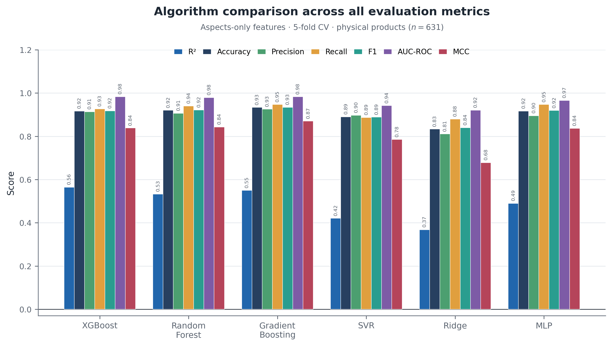
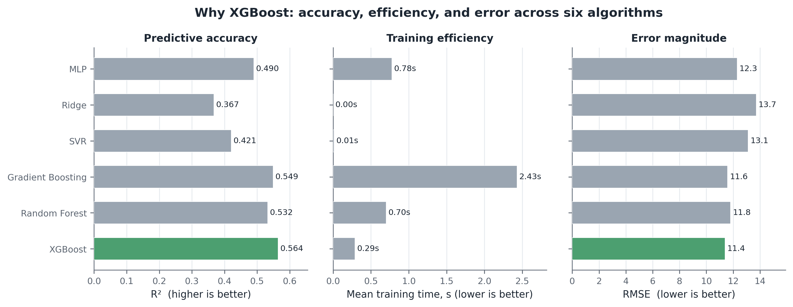
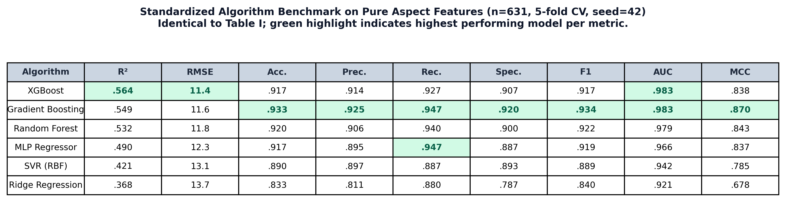
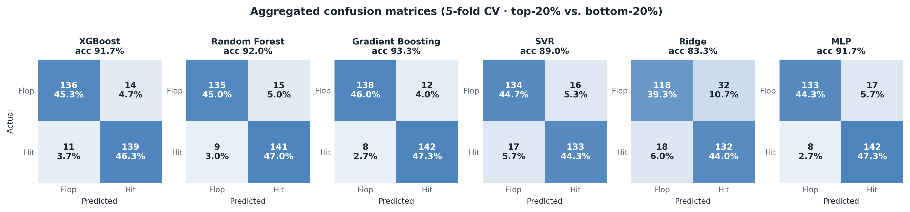
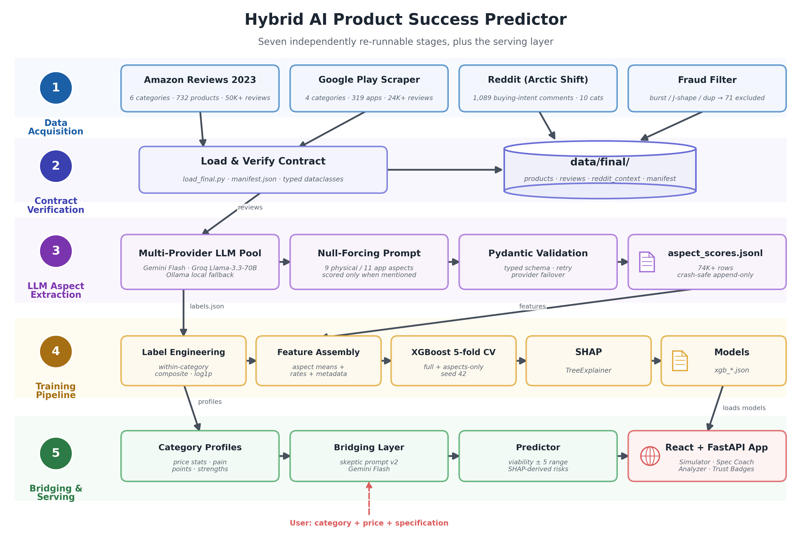
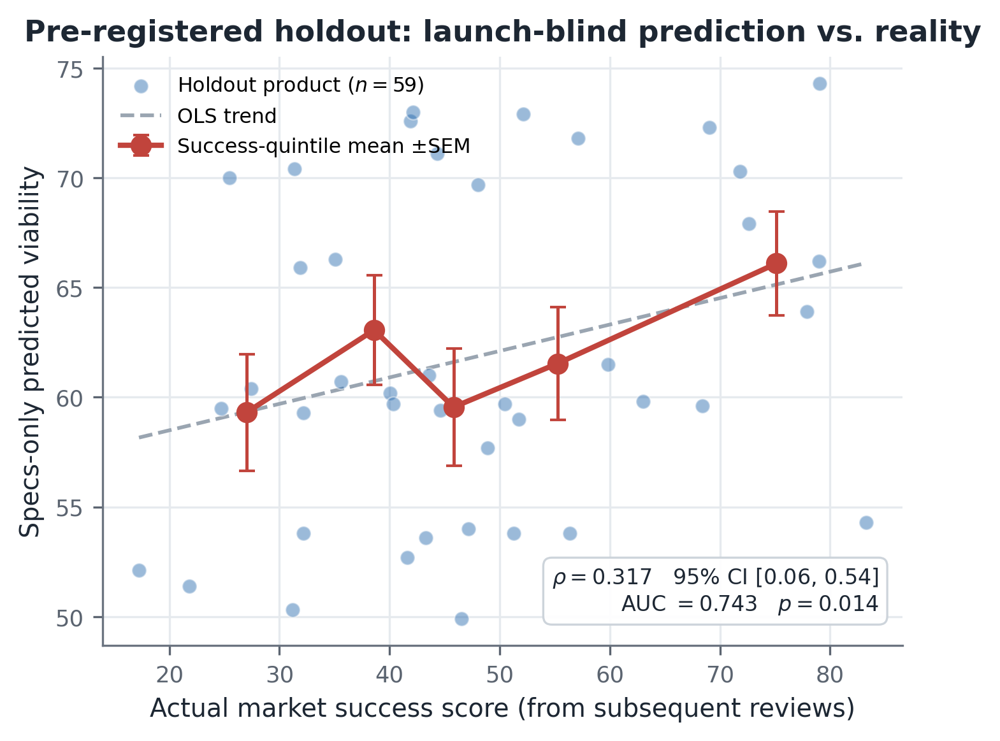
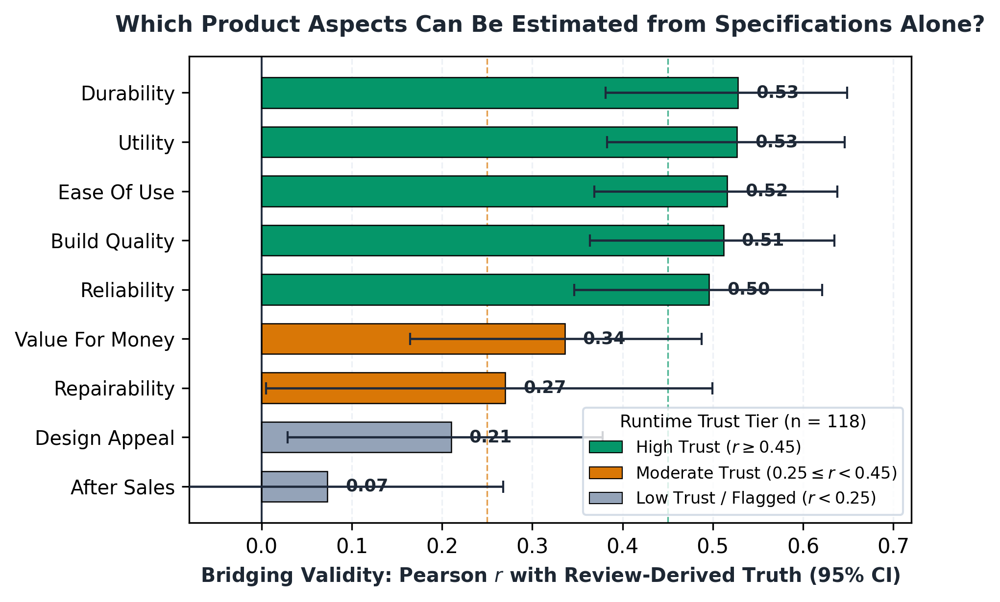
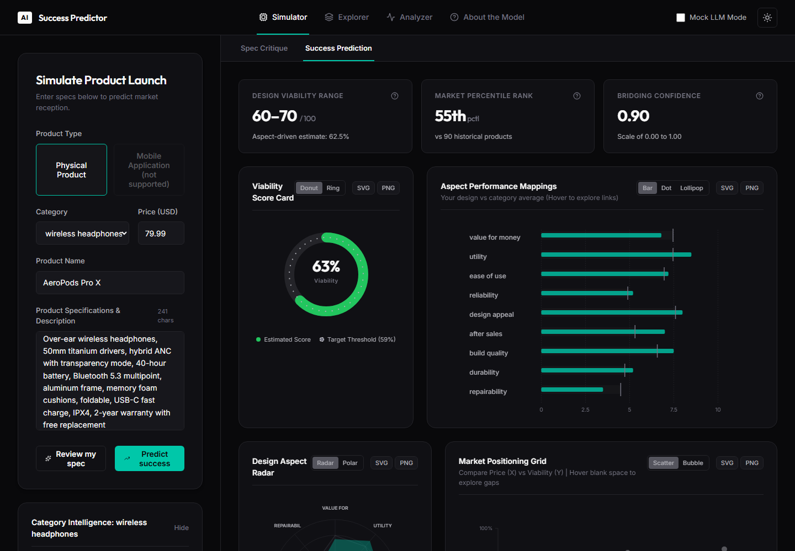
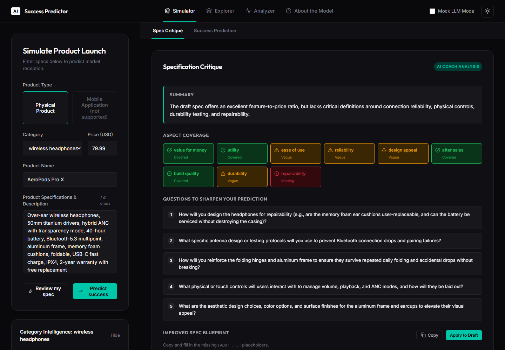
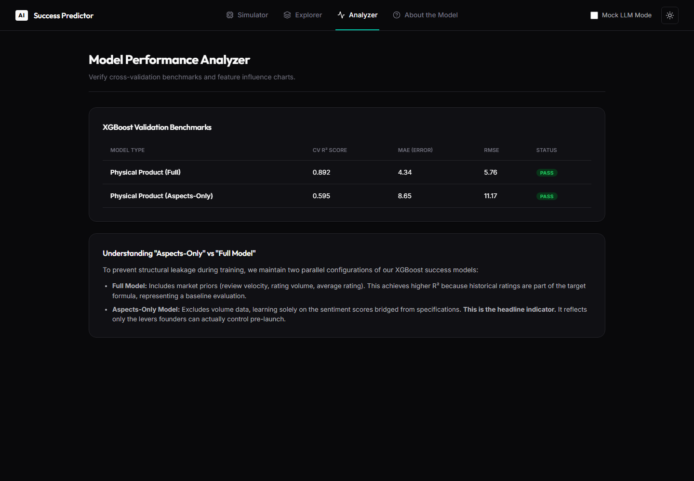

# Launch-Blind Product Viability Estimation from Specifications via LLM Aspect Bridging

**Raj Jagtap** — undergraduate, Computer Science and Engineering. Final-year capstone project, 2026.

> Readable Markdown export of the IEEE paper source (`paper_ieee/main.tex`). The typeset PDF is the canonical version; figures referenced here live in `paper_ieee/figures/`.

## Abstract

A product team commits its manufacturing budget long before anyone has held the product, yet almost every method for predicting whether a product will succeed needs signals that only appear after launch: reviews, ratings, sales. We built a pipeline that runs earlier than that. A large language model reads more than 43,000 real consumer reviews and scores them at the aspect level under a null-forcing prompt; gradient-boosted models learn which aspect profiles tend to succeed inside each category; and a bridging layer, told to reason like a skeptic and anchored to category statistics, estimates the aspect profile a new product would earn from its specification alone. We test the result on 640 physical products across five categories, twice, both times out of sample. On a leakage-controlled holdout of 118 products, whose test items were excluded before the model was retrained, specs-only predictions rank products against their real market outcomes at Spearman ρ = 0.529 (95% CI [0.31, 0.61]) and tell eventual bottom-quintile products from top-quintile ones at AUC = 0.903. A harder forward-in-time test, trained only on products launched on or before October 2021 and asked about later ones, holds the pooled ranking at ρ = 0.590 (AUC = 0.942, n = 125). Price enters the model as a single monotone-constrained feature, but the LLM aspect signal is not simply price in disguise: a price-free ablation stays largely orthogonal to price (r = 0.147) yet still ranks, so the aspects carry information price position does not, and viability falls as price rises at fixed quality. We give a boundary condition the same weight as the positive findings. Predictive validity follows how well a category's specifications encode experiential quality: it works for spec-expressive personal electronics, but for a commodity like ice makers the bridging step cannot separate products from capacity-and-speed numbers (bridging fidelity r ≈ 0.04), and there the method stops. Throughout, the system reports its own measured limits through reliability-weighted confidence, per-aspect trust tiers, and abstention, which we argue is the only honest thing a pre-production tool can do.

**Index Terms —** Product success prediction, aspect-based sentiment analysis, large language models, gradient boosting, pre-launch analytics, electronic word of mouth.

## Introduction

Large companies get to evaluate a prospective product with a market-research department, paid consumer panels, and analytics bought at a price a small firm cannot match. A small business or an independent maker has none of it. The call to manufacture a wireless headphone or a countertop appliance usually comes down to intuition, a look at the competition, and hope. Being wrong is not an abstraction: a single unsold inventory run can finish a small firm. Consumers absorb part of the cost too, paying for things that break, underwhelm, or were never really built for what they needed. This paper is an attempt to close some of that gap. We wanted to hand a business with no expensive market-intelligence stack an affordable, evidence-based read on whether a design is likely to satisfy its market *before* the money is spent building it, so that more of what gets made is worth what people pay for it.

The obstacle is structural, not incidental. Decades of research connect online reviews and electronic word of mouth (e-WOM) to sales and market outcomes (Chevalier and Mayzlin 2006; Dellarocas 2003; Chintagunta et al. 2010; Luca 2016), and today's sentiment pipelines extract strikingly fine-grained signal from review text (Zhang et al. 2023; Wang et al. 2025; Shan et al. 2025). All of it feeds on *post-launch* data. Yet at the one moment the decision actually matters, before anything is produced, there are no reviews, no ratings, and no sales to feed on. What exists is the specification and whatever the category has already taught us.

Our question is whether that is enough to work with. The idea we build on is *aspect bridging*. From more than 43,000 real reviews we first learn how consumers in a given category rate products along interpretable quality aspects (build quality, ease of use, value for money, and the rest), and how those profiles line up with eventual success. We then put a large language model in the seat of a skeptical market analyst, ground it in per-category statistics, and have it estimate the aspect profile an *unseen* product would earn from its specification alone. That estimate feeds the trained success model, which returns a launch-blind viability figure along with per-aspect explanations, trust tiers we have actually measured, and a flat refusal to answer when the specification says too little.

A tool that informs real money has to be validated like one, so our main contribution is methodological. The evaluation is launch-blind: each real product is re-judged from only what was knowable on the day it launched, and the prediction is checked against the outcome the market later delivered. We run two out-of-sample tests: a leakage-controlled holdout that pulls its test products before the model is retrained, and a forward-in-time split that trains on older products and predicts newer ones. The contributions are:

- **C1.** A null-forcing aspect-extraction scheme over 43,000+ reviews: the LLM may score an aspect only when the review gives verbatim evidence for it, never by inference, backed by typed validation and a crash-safe multi-provider pipeline (the Method section).
- **C2.** The bridging layer, a skeptic-prompted and category-grounded LLM estimator that turns a specification into an aspect profile, with absence penalties, grounding flags, and anchor discipline (the Method section).
- **C3.** Two out-of-sample evaluations—a leakage-controlled holdout and a forward-in-time temporal holdout—that confirm a real, price-complementary signal: ρ = 0.529 (holdout) and ρ = 0.590 (temporal), with AUC 0.903 and 0.942 (the Validation section).
- **C4.** An honest map of scope—which aspects a specification can predict and which it cannot—together with a diagnosed *boundary condition*: the method's validity tracks how well a category's specs encode experiential quality (the Scope and Boundary Conditions section).
- **C5.** An honesty layer—reliability-weighted confidence, per-aspect trust tiers, and abstention—wired into a deployed decision-support application whose interface puts the system's own measured limitations in front of the user (the System section).

## Related Work

### Reviews, e-WOM, and Market Outcomes

That online opinion moves markets is not in dispute. Chevalier and Mayzlin showed review valence shifting book sales from one retailer to another (Chevalier and Mayzlin 2006); Dellarocas cast digitized word of mouth as a new kind of economic feedback (Dellarocas 2003); Chintagunta et al. tied user reviews to box-office trajectories (Chintagunta et al. 2010); and Luca put a revenue figure on Yelp ratings (Luca 2016). Nearer to our own feature level, Archak et al. found that *aspect-level* content carries pricing power the star rating alone does not (Archak et al. 2011), Ghose and Ipeirotis connected review-text characteristics to economic impact (Ghose and Ipeirotis 2011), and Mudambi and Schuff asked what makes a review helpful in the first place (Mudambi and Schuff 2010). Social-media signals have been read the same way to forecast outcomes (Asur and Huberman 2010). Every one of these works after the fact. The nearest thing to our goal is Narayanan et al., who predict reception from pre-release chatter about an announced product (Narayanan et al. 2020); our setting is harder still, since we assume no product-specific chatter exists at all, only the specification and the category's history.

Review streams are also adversarial. Opinion spam goes back to Jindal and Liu (Jindal and Liu 2008), convincing fake reviews can be written to order (Ott et al. 2011), and the incentive to manipulate them is plain (Mayzlin et al. 2014). The corpus-level fraud filter in the Data section is our response to this line of work.

### Aspect-Based Sentiment Analysis

Aspect-based sentiment analysis (ABSA) started with frequency- and lexicon-based aspect mining (Hu and Liu 2004; Liu 2012), was given a common benchmark by SemEval-2014 (Pontiki et al. 2014), and has since been carried mostly by neural methods, surveyed in (Zhang et al. 2023). The machinery keeps improving—multi-feature fusion graph attention networks (Wang et al. 2025), curriculum-learning hybrids (Lange et al. 2025), transformer pipelines for bilingual e-commerce satisfaction (Shan et al. 2025), multi-source sentiment fusion (SESR 2025). Our difference is one of purpose, not architecture. We use ABSA as a *measurement instrument*: it turns unstructured reviews into a per-product aspect profile that then becomes the input to supervised learning, and we hold it to a null-forcing, evidence-quoting discipline meant for downstream trustworthiness rather than benchmark accuracy.

### LLMs as Extractors and Estimators

Transformer language models (Vaswani et al. 2017; Devlin et al. 2019), scaled up into instruction-following generalists (Brown et al. 2020; Ouyang et al. 2022; OpenAI 2023; Gemini Team 2023; Touvron et al. 2023), now label text about as reliably as a human crowd (Gilardi et al. 2023) and turn up more and more as zero-shot parts of e-commerce pipelines—product classification (Roumeliotis et al. 2025), description generation from reviews (Gutierrez et al. 2025), numeric value prediction in industrial systems (Hidayat et al. 2025). Reasoning-eliciting prompting (Wei et al. 2022) and the wider foundation-model programme (Bommasani et al. 2021) treat LLMs as general-purpose estimators. Our bridging layer belongs to this line but joins two disciplines that are seldom tested together: a built-in skepticism toward adversarial input, because marketing copy is written to sound good for flops and hits alike, and *launch-blind outcome validation*, which holds the LLM's estimates up against the market reality that actually followed.

### Gradient Boosting for Tabular Prediction

For tabular product features, gradient-boosted trees (Friedman 2001; Chen and Guestrin 2016; Ke et al. 2017) remain the default to beat, ahead of both classic ensembles (Breiman 2001) and neural alternatives, and they show up across e-commerce supply chains (Sayyad et al. 2024), sentiment-augmented financial forecasting (Zhen et al. 2025; Shang 2025), and multi-criteria recommendation (Rakee et al. 2025). We chose XGBoost for two reasons in particular: it handles missing values natively, so an unmentioned aspect stays missing rather than being imputed, and it pairs with SHAP attributions (Lundberg and Lee 2017) that turn a prediction into an explanation in terms of design levers. Our data infrastructure rests on the Amazon reviews corpora (He and McAuley 2016; Hou et al. 2024), and we put confidence intervals on results with the bootstrap (Efron 1979). One further link is worth naming: our insistence that the interface show the model's limits echoes a recent argument from the management literature that AI-assisted decisions need calibrated human autonomy (Cristofaro and Banon-Gomis 2026).

## Data

The corpus comes from the Amazon Reviews 2023 dataset (Hou et al. 2024), restricted to five physical-product categories: wireless headphones, Bluetooth speakers, smartwatches, power banks, and ice makers. We kept English reviews of 10–400 words, dropped any product with fewer than five reviews, and normalized timestamps; every rating sits in [1,5]. What remains is 640 products, and extraction ran over more than 43,000 reviews. The choice of categories was about signal, not convenience: two early candidates, smartphones and general kitchen appliances, were thrown out because accessory listings contaminated them badly, and ice makers were assembled as a clean single-function category from the Appliances pool to take their place.

Because review streams can be gamed (Jindal and Liu 2008; Mayzlin et al. 2014), we ran a fraud filter before any label was computed. A product was flagged when more than 40% of its sampled reviews landed inside a single 14-day window, when its rating distribution was extreme-J-shaped, or when more than 30% of its reviews were near-duplicates (Jaccard > 0.7 on word sets). Nine products tripped the filter, leaving 631 for training.

The regression target is a within-category composite, success = 100 (0.40 volume + 0.35 rating + 0.25 velocity), with each component min–max normalized inside its own category and log(1+x) applied to the heavy-tailed counts. Normalizing within category is not a detail: 500 reviews mean one thing for an ice maker and something else entirely for a pair of wireless headphones.

**Survivorship disclosure.** The five-review floor keeps out any product that launched and drew no attention at all. Every claim we make is therefore a claim about ranking among products that did reach the market's notice. A "flop," in our vocabulary, is the bottom success quintile of these survivors, not a product nobody ever bought. The Limitations section works through what that costs us.

## Method

### Aspect Extraction

Each review is broken into aspect-level sentiment against a frozen schema of nine aspects: six shared consumer aspects (value for money, utility, ease of use, reliability, design appeal, after-sales) and three physical-product aspects (build quality, durability, repairability). The prompt is *null-forcing* by design. An aspect earns a score (0–10) only if the review actually discusses it; every non-null score must quote a verbatim phrase from the review as evidence; and the star rating is given as context but banned as a source of scores. A review that praises only sound quality comes back with null for durability, because the silence is information and we will not invent around it. Every output is checked against a typed schema. An invalid response is retried once with the error appended, then handed to the next provider, and on a third failure the review is logged and skipped, so one bad response can never stall a batch that runs for days. Extraction covered more than 43,000 reviews on a multi-provider cloud pool (Gemini Flash, Groq Llama-3.3-70B, Cerebras, Mistral, and SambaNova) with per-key rate tracking, append-only crash-safe logging, and resume support; we tried a local model too but dropped it after a quality audit. Ahead of the full run, a 30-review hand-validation gate confirmed that unmentioned aspects came back null and that each evidence phrase really did appear in its review.

### Success Models and Algorithm Selection

Product-level features roll the extraction stream up into a mean score and a mention rate per aspect. An aspect nobody mentions stays missing rather than imputed, which XGBoost (Chen and Guestrin 2016) handles on its own. On top of these we add metadata: price, average rating, log rating count, review velocity, a brand-recognition tier, and category. The regressors are gradient-boosted (600 estimators, depth 5, learning rate 0.05, seed 42) and trained under 5-fold cross-validation, and we report two variants that deserve very different levels of trust. The *full* model reaches CV R² = 0.892 on physical products, but 35% of its own target is the average rating that it also takes as a feature (corr = 0.457). We flag that leakage openly and read the number as a ceiling on fit, not a sign of insight. The *headline* variant removes only the genuinely leakage-prone metadata—average rating, rating count, and velocity, all of which are ingredients of the success label—while keeping price, which is *not* part of the label and is knowable before launch, as a feature. That model scores R² = 0.595 on physical products and stands behind every claim in this paper. Each feature also carries a monotonic constraint that pins the sign of its effect: every review aspect and the brand tier are held non-decreasing (+1), and price non-increasing (-1). The constraints keep the model from picking up the spurious inverse relationships a noisy popularity label invites—a *lower* value-for-money score nudging predicted viability up, for instance, which had once flipped the headline model's response to price and produced backwards attributions. With them, every explanation carries the right sign and the prediction is monotone in price (a higher price never raises viability at fixed quality), and empirically they also *improve* out-of-sample generalization rather than costing accuracy. Strip out the brand tier and price as well, leaving strictly LLM-extracted features, and R² = 0.566—the pure aspect-based contribution.

**Why XGBoost.** We did not take the learning algorithm for granted. Six of them were benchmarked on the same aspects-only feature matrix under the same 5-fold CV (seed 42, n = 631 physical products), and Table 1 with Fig. 1 report every metric. XGBoost posts the best R² (0.564), the lowest RMSE (11.4), and the best AUC-ROC for separating the top from the bottom quintile (0.983), and it trains in 0.29 s, which is 2.5× faster than Random Forest and 8× faster than sklearn Gradient Boosting. The runner-up, sklearn Gradient Boosting (R² = 0.549), ties it on AUC but needs 7× the time for want of histogram-based splitting (Ke et al. 2017). Random Forest (Breiman 2001) (R² = 0.532) and the MLP (R² = 0.490) trail, and the further drop to SVR (Cortes and Vapnik 1995) (R² = 0.421) and Ridge Regression (Hoerl and Kennard 1970) (R² = 0.368) shows how much the nonlinear interactions matter. The ordering matches recent large-scale benchmarks where tree ensembles still beat deep learning on ordinary tabular data (Grinsztajn et al. 2022; Shwartz-Ziv and Armon 2022).

Accuracy aside, three features of this particular problem play to XGBoost's strengths. One is native missing-value handling. Aspect scores go structurally missing whenever a review skips an aspect, and XGBoost learns a split direction for the missing entries with no imputation (Chen and Guestrin 2016), where Ridge and SVR would need a fill strategy that only adds noise. Another is native categorical support: the `category` feature goes in directly through the `enable_categorical` flag, with no one-hot encoding, so the histogram learner keeps the structure it can use. The third is SHAP compatibility. TreeExplainer (Lundberg and Lee 2017) returns exact, polynomial-time Shapley values for tree ensembles, and those drive the per-prediction risk and strength explanations the application shows (the System section); kernel SHAP on an MLP or an SVR is approximate and slower by orders of magnitude.

**Table 1.** Algorithm comparison on aspects-only features (physical products, n=631, 5-fold CV, seed 42). The task is regression, so R²/RMSE are the *primary* metrics; the classification metrics are *derived* by binarizing the predicted score at the top- vs. bottom-quintile and are shown for completeness. Best value per metric in **bold**.

| Algorithm | R² | RMSE | Acc. | Prec. | Rec. | Spec. | F1 | AUC | MCC |
|---|---|---|---|---|---|---|---|---|---|
| **XGBoost** | **.564** | **11.4** | .917 | .914 | .927 | .907 | .917 | **.983** | .838 |
| Grad. Boosting | .549 | 11.6 | **.933** | **.925** | **.947** | **.920** | **.934** | **.983** | **.870** |
| Random Forest | .532 | 11.8 | .920 | .906 | .940 | .900 | .922 | .979 | .843 |
| MLP | .490 | 12.3 | .917 | .895 | **.947** | .887 | .919 | .966 | .837 |
| SVR (RBF) | .421 | 13.1 | .890 | .897 | .887 | .893 | .889 | .942 | .785 |
| Ridge | .368 | 13.7 | .833 | .811 | .880 | .787 | .840 | .921 | .678 |

Fig. 1 lays all seven metrics out together. Because the target is a continuous success score, the regression metrics come first, and there XGBoost holds the best R² and RMSE and ties for the best AUC-ROC. Gradient Boosting nudges ahead on the *derived* classification metrics, but those gaps live inside cross-validation fold noise, it burns about 8× the training time, and it cannot swallow the structurally missing aspect features without imputation, which XGBoost can. The pooled confusion matrices in Fig. 4 say the same thing: every tree ensemble clears 90% accuracy at telling eventual hits from flops.

*Figure 1. All evaluation metrics across six algorithms on the aspects-only feature set (5-fold CV, n=631). Metrics: R², Accuracy, Precision, Recall, F1, AUC-ROC, and MCC.*

*Figure 2. Three-panel accuracy–efficiency trade-off: predictive accuracy (R²), training time, and error magnitude (RMSE). XGBoost leads on accuracy and error with competitive speed.*

*Figure 3. Complete numerical comparison across all evaluation metrics. Bold verdict column summarises the overall ranking: XGBoost is the only algorithm rated BEST on both regression accuracy and classification-derived measures while maintaining competitive training time.*

*Figure 4. Aggregated confusion matrices (5-fold CV, top-20% vs. bottom-20% products). Counts and percentages for each quadrant: true negatives (flops correctly identified), false positives, false negatives, and true positives (hits correctly identified).*

### Bridging: Estimating Aspects from Specifications

The bridging layer asks an LLM for the aspect profile a product *would* earn after months of real use, given nothing but its specification and a category profile: price quartiles, mean aspect scores, and the leading pain points and strengths mined from real reviews. Our first prompt believed what it read, and it failed in an instructive way. Marketing copy is optimistic by construction, selling flops and hits with equal conviction, and the predictions bunched into a narrow, rosy band. The production prompt runs on three rules of skepticism. Under *adjective blindness*, only verifiable facts justify a score—materials, standards, numbers, warranty terms: "powerful bass" is noise, while "50 mm drivers" is evidence. Under the *absence rule*, a spec that offers no concrete evidence for an aspect is itself the signal, since a competent team states its strengths, so the aspect is scored below the category mean and flagged as ungrounded. Under *anchor discipline*, the category mean is whatever the median real product achieves, and any score more than two points above it has to point to a fact in the spec.

### The Honesty Layer

Some aspects bridge more reliably than others, and rather than hide that, the system measures it directly and acts on it. For each aspect we compute the correlation between the bridged estimate and the review-derived ground truth across all bridged products (the Validation section), which gives an empirical fidelity weight per aspect. A prediction's confidence is then a *reliability-weighted* grounded fraction: each aspect adds to confidence in proportion to how well it actually bridges, so aspects a spec cannot convey (after-sales, r ≈ 0.07) no longer move confidence, while the high-fidelity ones (utility, durability, ease of use, build quality, reliability, all r ≈ 0.5) carry it. The same measurement sets each aspect's trust badge: STRONG (utility, ease of use, build quality, durability, reliability), MODERATE (value for money, repairability), or WEAK (design appeal, after-sales). When confidence drops below a warning threshold, the interface says outright that the estimate is leaning on category averages; below a lower threshold it hides the number entirely and sends the user to the spec coach. The headline viability is rank-calibrated onto a readable 0–100 scale against a reference distribution of real products, and shown as a range rather than a false-precision decimal.

*Figure 5. Pipeline overview across five physical categories: extraction, label engineering, feature assembly, training, category profiling, and the bridging/prediction service.*

## Validation

The question behind our validation is a counterfactual: *if this system had existed on the day a real product launched, would its specs-only estimate have called that product's eventual market outcome?* We answer it launch-blind and out of sample. For every product we evaluate, the bridging layer sees only what was knowable at launch: name, brand, price, and the manufacturer's specification copy. Reviews, ratings, and sales signals are held back. The bridged profile goes into the aspects-only model, and its estimate is checked against the product's real within-category success score, computed from the reviews the product went on to collect. Table 2 lays out the three evaluations; the two holdouts are where the evidence is.

**Table 2.** Reliability summary. The two out-of-sample holdouts are the primary evidence; both scales run 0 (useless) to 1 (perfect). Within-category ρ is the mean over categories and is the stricter measure.

| Evaluation | ρ (pooled) | AUC | within-cat. ρ |
|---|---|---|---|
| Cross-validation | R² = 0.595 aspects-only (0.566 pure); 0.892 full | — | — |
| Out-of-sample holdout (n=118) | 0.529 | 0.903 | 0.39 |
| Temporal holdout (n=125) | 0.590 | 0.942 | 0.16 |

### Leakage-Controlled Out-of-Sample Holdout

We bridged 118 products, drawn from all five categories, through the frozen production pipeline using only their specifications. The model was then *retrained from scratch on the other 513 products*, with every holdout product removed and category priors computed on the training split alone, so nothing in the test set can influence the model that scores it. Specs-only predictions rank the held-out products against their real outcomes at Spearman ρ = 0.529 (p = 7.6×10⁻⁷), with a 10,000-sample bootstrap 95% CI of [0.377, 0.654] that clears zero, and they tell bottom-quintile from top-quintile products at AUC = 0.903. Mean predicted viability climbs monotonically across the actual success quintiles (55.4 → 58.1 → 58.5 → 62.8 → 65.4; Fig. 6), ten points end to end. At n = 118 the pooled ρ accounts for roughly 19% of the rank variance; this is a screening signal across a portfolio of candidate designs, not a verdict on any single product.

*Figure 6. Leakage-controlled holdout (n=118): specs-only predicted viability versus actual market success, with monotonic success-quintile means.*

### Forward-in-Time Temporal Holdout

A random split can still leak era-specific regularities, so we ran the harder test a pre-launch tool really faces: predicting the future. Training used only the 505 products launched on or before October 2021 (best iteration chosen by 5-fold CV), and the model then predicted the 125 products launched afterward, from specifications alone. The pooled ranking not only survives but sharpens: ρ = 0.590 (p = 1.2×10⁻¹¹, CI [0.486, 0.696]) and AUC = 0.942. A signal that holds across a temporal split answers the most common objection to any pre-launch claim before it is raised.

The pooled numbers do get some help from *between-category* structure, since the target is normalized within category. The stricter yardstick is the mean within-category ρ, and there the two holdouts part ways honestly: 0.39 on the random split falls to 0.16 forward-in-time. Predicting the future inside a single category is genuinely harder than interpolating across a random split, and exposing that is precisely what a temporal test is for. We report both and take the within-category figure as the conservative claim.

### Baselines and Price Orthogonality

A launch-blind correlation is only worth something if it is not just rediscovering price. On the holdout, a within-category price-percentile baseline already reaches ρ = 0.386 against actual success—a strong baseline, since expensive segments succeed on their own terms. Our model does use price, as one monotone-constrained feature, but its LLM-extracted aspects carry what price position does not: the headline model reaches ρ = 0.529, and a price-free ablation—the same model with price taken out—still reaches ρ = 0.475 while staying largely orthogonal to price (r = 0.147 between its prediction and the price percentile). The aspect signal therefore complements price rather than standing in for it, and, unlike a price rule of thumb, the model can say *why* in terms of design levers.

### Which Aspects Can Be Estimated from Specs

Aspect by aspect, the bridged estimates track the review-derived ground truth at r = 0.53 for utility and durability, 0.52 for ease of use, 0.51 for build quality, and 0.50 for reliability; then 0.34 for value for money and 0.27 for repairability; and at the bottom, design appeal (r = 0.21) and after-sales (r = 0.07) are all but unestimable from a specification (Fig. 7; mean r ≈ 0.39, n = 118). None of this is surprising: service quality never shows up on a spec sheet, and aesthetics are subjective in a way category norms do not pin down. These measured correlations are the very weights the honesty layer uses, so the interface's trust badges are not asserted—they are the validation numbers themselves.

*Figure 7. Per-aspect validity of bridged estimates (r with 95% CI, n=118), colored by the trust tier shown to users. These correlations double as the confidence weights.*

## Scope and Boundary Conditions

A system meant to inform real decisions ought to name where it breaks as plainly as where it works, so we give a diagnosed boundary condition the same prominence as the positive results. The method's predictive validity tracks *how well a category's specifications encode experiential quality*, and the clearest case is ice makers.

On the surface ice makers are a paradox: of every category they have the *strongest* within-category link between real review aspects and success (mean |r| = 0.32, against 0.09–0.24 elsewhere) and the best aspect coverage in extraction, yet their bridged predictions are the weakest of all (holdout ρ ≈ 0.11; forward-in-time ρ ≈ 0). The cause is not extraction and not the label; it is the bridging step, and the diagnosis is clean. The LLM hands almost the same aspect scores to every ice maker—a bridged-score standard deviation across products of just 0.08 for reliability and 0.13 for build quality and durability—because an ice-maker spec is a set of capacity-and-speed numbers ("26 lb/day, 9 cubes in 6 minutes") that say nothing about reliability, durability, or build. With nothing to separate them, the model falls back to the category prior for each one, and flat inputs carry no ranking information. Ice-maker bridging fidelity comes out at r ≈ 0.04, against ≈ 0.39 pooled and 0.45–0.56 for the same aspects in the personal-electronics categories.

The lesson generalizes. Where a category's specifications describe experiential attributes—sound, comfort, battery life for headphones, speakers, and smartwatches—bridging fidelity is high and forward prediction works. Where they describe only physical capacity, bridging cannot tell products apart and the method is bounded, no matter how much signal the underlying reviews hold. The temporal holdout shows a cousin of this effect: power banks rank well on a random split (ρ = 0.43) but not forward-in-time (ρ ≈ 0), which fits real technological drift—newer gallium-nitride and USB-C designs a model trained on older stock has never seen. We therefore scope the method to spec-expressive, technologically stable categories, and the interface's abstention machinery is that same boundary expressed at runtime.

## System

The pipeline is a chain of independently re-runnable stages (Fig. 5). Each one writes its output to disk and skips expensive work unless told to redo it. Extraction is crash-safe and resumable, which mattered in practice: the full batch runs for days of rate-limited API calls across a rotating provider pool. Feature manifests are serialized to disk and the prediction code builds its input vectors by walking them, so the serving path cannot quietly drift out of step with training. One end-to-end smoke test regenerates synthetic data, runs every stage in a sandbox, and gates every change to the code.

The user-facing application (Fig. 8a) is a React front end over a FastAPI backend, deployed under Docker. A founder enters a product's category, price, and specification and gets the whole analysis back: a rank-calibrated viability range, a percentile position against real products, per-aspect estimates drawn against category averages, and top risks and strengths from SHAP (Lundberg and Lee 2017) attributions taken relative to the category-average product. Because the attributions are relative in that way, the cards agree with the aspect-vs-average chart by construction, and under the model's monotonic constraints an above-average aspect always reads as a strength and a below-average one as a risk—each phrased as a design lever the founder can actually move. A market-gap report rounds it out, quoting verbatim customer complaints for the category pain points a design does not convincingly address. Every aspect estimate shows its trust badge and grounding flag, and confidence is reliability-weighted, so a specification that grounds only low-fidelity aspects is reported at low confidence and, below threshold, replaced by an explanation rather than a number. The model also conditions on company and product maturity, so a first product from an unknown brand is judged differently from a line extension by an established one.

The spec coach (Fig. 8b) closes the loop for users who are not practiced at writing specs. A single LLM call rates the draft's coverage of each aspect as covered, vague, or missing, asks at most five questions ordered by how much each answer would sharpen the prediction, and rewrites the spec while keeping every fact the user stated and inserting explicit placeholders for the decisions still to be made. By construction, the coach may not invent a material, a number, or a feature the user did not state.

*Figure 8. The application. (a) Prediction dashboard with viability range, percentile rank, and aspect-vs-category chart. (b) Spec coach. (c) Analyzer view showing the honest benchmark table.*

## Limitations

**Survivorship bias is the biggest limitation, and it bounds every claim in this paper.** The corpus asks for at least five reviews per product, so products that launched and drew no attention—arguably the truest flops—simply are not there. Every result here is about ranking among products that reached the market's attention. Whether the system could flag a product headed for no traction at all is untested, and with this data it cannot be tested.

The second limit is the target itself: our success score is a review-derived popularity composite, not units sold, which are not publicly available. A genuine sales signal (sales rank, say) is the single highest-leverage improvement left on the table. The third is statistical power and scope: the holdouts run n = 118 and 125, the validated claims cover five physical categories, and within-category forward skill is modest (ρ ≈ 0.16) and concentrated in the spec-expressive categories (the Scope and Boundary Conditions section). The fourth concerns the input. Our "specifications" are launch-day spec sheets and marketing copy, the closest launch-knowable proxy we can recover after the fact, optimistic in ways the skeptic prompt curbs without erasing. The fifth is reproducibility, since the pipeline leans on hosted LLMs. We run bridging at temperature zero and memoize each result by a hash of its input, so repeated predictions for the same specification are identical within a deployment; what remains is that hosted model versions drift over time, so reproducing results across time needs the archived extraction outputs we release with the code. Finally, review text can be gamed: the fraud filter caught 9 suspect products, but a sophisticated manipulation (Mayzlin et al. 2014) would get past it. Folding community-derived buying priorities into the bridging context is a promising but unconfirmed direction we leave to future work.

## Conclusion

We set out to ask whether a product's market fate can be read, at least in part, from its specification alone, before any consumer has touched it. Within carefully stated bounds, the answer is yes. An LLM that extracts aspect sentiment from more than 43,000 reviews, a gradient-boosted model that learns which aspect profiles succeed, and a skeptic-prompted bridging layer that estimates those profiles from specs together produce a launch-blind signal of ρ = 0.529 on a leakage-controlled holdout and ρ = 0.590 forward-in-time, against real market outcomes. That signal complements price rather than proxying for it, the score declines monotonically as price rises at fixed quality, and predicted viability rises monotonically across the success tiers, from flops to category leaders.

The contribution likely to last, we think, is not that point estimate but the map around it: which aspects a specification can predict (utility, ease of use, build quality, durability, reliability), which it cannot (after-sales service, aesthetics), and which categories the method works in at all—spec-expressive personal electronics—as against where it is bounded, like commodity appliances whose specs encode capacity but not experience. For the small businesses that motivated this work, a map like that is the difference between an oracle they should not trust and an instrument they can: a pre-production screen that shifts the odds toward products their users find worth paying for. A tool that knows its own limits and shows them, through reliability-weighted confidence, trust badges, and abstention, is the only honest form such a tool can take at the current state of the art.

## References

- **Archak et al. 2011.** Deriving the Pricing Power of Product Features by Mining Consumer Reviews. *Management Science*.
- **Asur and Huberman 2010.** Predicting the Future With Social Media. *Proc. IEEE/WIC/ACM Int. Conf. on Web Intelligence*.
- **Bommasani et al. 2021.** On the Opportunities and Risks of Foundation Models. *arXiv preprint arXiv:2108.07258*.
- **Breiman 2001.** Random Forests. *Machine Learning*.
- **Brown et al. 2020.** Language Models Are Few-Shot Learners. *Advances in Neural Information Processing Systems*.
- **Chen and Guestrin 2016.** XGBoost: A Scalable Tree Boosting System. *Proc. ACM SIGKDD Int. Conf. on Knowledge Discovery and Data Mining*.
- **Chevalier and Mayzlin 2006.** The Effect of Word of Mouth on Sales: Online Book Reviews. *Journal of Marketing Research*.
- **Chintagunta et al. 2010.** The Effects of Online User Reviews on Movie Box Office Performance. *Marketing Science*.
- **Cortes and Vapnik 1995.** Support-Vector Networks. *Machine Learning*.
- **Cristofaro and Banon-Gomis 2026.** Dancing With the Algorithm: A Framework to Navigate Knowledge and Autonomy in AI-Assisted Managerial Decisions. *Journal of Knowledge Management*.
- **Dellarocas 2003.** The Digitization of Word of Mouth: Promise and Challenges of Online Feedback Mechanisms. *Management Science*.
- **Devlin et al. 2019.** BERT: Pre-Training of Deep Bidirectional Transformers for Language Understanding. *Proc. NAACL-HLT*.
- **Efron 1979.** Bootstrap Methods: Another Look at the Jackknife. *Annals of Statistics*.
- **Friedman 2001.** Greedy Function Approximation: A Gradient Boosting Machine. *Annals of Statistics*.
- **Gemini Team 2023.** Gemini: A Family of Highly Capable Multimodal Models. *arXiv preprint arXiv:2312.11805*.
- **Ghose and Ipeirotis 2011.** Estimating the Helpfulness and Economic Impact of Product Reviews: Mining Text and Reviewer Characteristics. *IEEE Transactions on Knowledge and Data Engineering*.
- **Gilardi et al. 2023.** ChatGPT Outperforms Crowd Workers for Text-Annotation Tasks. *Proceedings of the National Academy of Sciences*.
- **Grinsztajn et al. 2022.** Why Do Tree-Based Models Still Outperform Deep Learning on Typical Tabular Data?. *Advances in Neural Information Processing Systems*.
- **Gutierrez et al. 2025.** Zero-Shot Product Description Generation From Customers Reviews. *Proc. Int. Conf. on Agents and Artificial Intelligence (ICAART)*.
- **He and McAuley 2016.** Ups and Downs: Modeling the Visual Evolution of Fashion Trends With One-Class Collaborative Filtering. *Proc. Int. Conf. on World Wide Web (WWW)*.
- **Hidayat et al. 2025.** Leveraging Large Language Models for Discrepancy Value Prediction in Custody Transfer Systems: A Comparative Analysis of Probabilistic and Point Forecasting Approaches. *IEEE Access*.
- **Hoerl and Kennard 1970.** Ridge Regression: Biased Estimation for Nonorthogonal Problems. *Technometrics*.
- **Hou et al. 2024.** Bridging Language and Items for Retrieval and Recommendation. *arXiv preprint arXiv:2403.03952*.
- **Hu and Liu 2004.** Mining and Summarizing Customer Reviews. *Proc. ACM SIGKDD Int. Conf. on Knowledge Discovery and Data Mining*.
- **Jindal and Liu 2008.** Opinion Spam and Analysis. *Proc. Int. Conf. on Web Search and Data Mining (WSDM)*.
- **Ke et al. 2017.** LightGBM: A Highly Efficient Gradient Boosting Decision Tree. *Advances in Neural Information Processing Systems*.
- **Lange et al. 2025.** Curriculum Learning for a Hybrid Approach for Aspect-Based Sentiment Analysis. *Expert Systems with Applications*.
- **Liu 2012.** Sentiment Analysis and Opinion Mining. *Morgan & Claypool*.
- **Luca 2016.** Reviews, Reputation, and Revenue: The Case of Yelp.com. *Harvard Business School Working Paper 12-016*.
- **Lundberg and Lee 2017.** A Unified Approach to Interpreting Model Predictions. *Advances in Neural Information Processing Systems*.
- **Mayzlin et al. 2014.** Promotional Reviews: An Empirical Investigation of Online Review Manipulation. *American Economic Review*.
- **Mudambi and Schuff 2010.** What Makes a Helpful Online Review? A Study of Customer Reviews on Amazon.com. *MIS Quarterly*.
- **Narayanan et al. 2020.** Product Pre-Launch Prediction From Resilient Distributed e-WOM Data. *IEEE Access*.
- **OpenAI 2023.** GPT-4 Technical Report. *arXiv preprint arXiv:2303.08774*.
- **Ott et al. 2011.** Finding Deceptive Opinion Spam by Any Stretch of the Imagination. *Proc. Annual Meeting of the ACL*.
- **Ouyang et al. 2022.** Training Language Models to Follow Instructions With Human Feedback. *Advances in Neural Information Processing Systems*.
- **Pontiki et al. 2014.** SemEval-2014 Task 4: Aspect Based Sentiment Analysis. *Proc. 8th Int. Workshop on Semantic Evaluation (SemEval)*.
- **Rakee et al. 2025.** TEMUL: Tensor-Based Deep Learning Approach for Multi-Criteria Recommender System. *IEEE Access*.
- **Roumeliotis et al. 2025.** LLMs for Product Classification in E-Commerce: A Zero-Shot Comparative Study of GPT and Claude Models. *Natural Language Processing Journal*.
- **Sayyad et al. 2024.** Optimizing e-Commerce Supply Chains With Categorical Boosting: A Predictive Modeling Framework. *IEEE Access*.
- **SESR 2025.** Research on Sentiment Analysis Based on Multi-Source Data Fusion. *Socio-Economic Statistics Research*.
- **Shan et al. 2025.** Examining Customer Satisfaction Through Transformer-Based Sentiment Analysis for Improving Bilingual E-Commerce Experiences. *IEEE Access*.
- **Shang 2025.** Sentiment-Driven Bitcoin Price Range Forecasting: Enhancing CART Decision Trees With High-Dimensional Indicators and Twitter Dynamics. *IEEE Access*.
- **Shwartz-Ziv and Armon 2022.** Tabular Data: Deep Learning Is Not All You Need. *Information Fusion*.
- **Touvron et al. 2023.** LLaMA: Open and Efficient Foundation Language Models. *arXiv preprint arXiv:2302.13971*.
- **Vaswani et al. 2017.** Attention Is All You Need. *Advances in Neural Information Processing Systems*.
- **Wang et al. 2025.** MultiFeature Fusion Graph Attention Network for Aspect-Based Sentiment Analysis. *Knowledge-Based Systems*.
- **Wei et al. 2022.** Chain-of-Thought Prompting Elicits Reasoning in Large Language Models. *Advances in Neural Information Processing Systems*.
- **Zhang et al. 2023.** A Survey on Aspect-Based Sentiment Analysis: Tasks, Methods, and Challenges. *IEEE Transactions on Knowledge and Data Engineering*.
- **Zhen et al. 2025.** A Multi-Feature Selection Fused With Investor Sentiment for Stock Price Prediction. *Expert Systems with Applications*.
